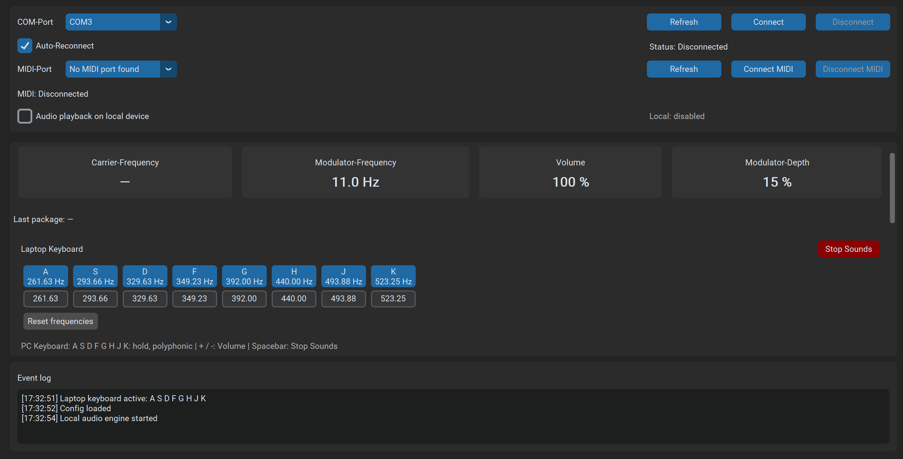
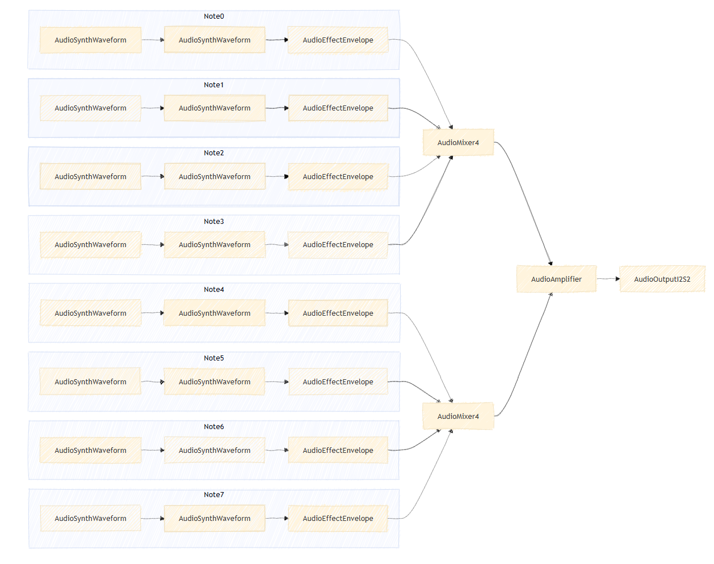

# Audio Module GUI

GUI for Audio Module + functionality to test sounds




## About this application

This application lets you experiment with various synthesis methods that can be put together in the Teensy Audio Design Tool. It includes a GUI to configure synthesis method and parameters. At the moment you can choose between the Synthesis modes: 
- FM (approved on AM)
- Pure Sine (approved on AM)
- Additive
- Subtractive
- Wavetable
- Granular

Every Synthesis Mode includes presets of parameter configurations which you can try out. You can also adjust the parameters manually.

## Requirements

### Use on local device:

- Python 3.12+

### To use MIDI Keyboard:

- Connect MIDI-Keyboard, then you will be able to connect it in the GUI and use it as input.

### To use Audio Module (Teensy + Amplifier + Speaker):

Currently the Audio Module use is in a prototype state.
So please consult Flo, before using the physical Audio Module for the first time: [florian.purschke@ms.informatik.uni-stuttgart.de](mailto:florian.purschke@ms.informatik.uni-stuttgart.de) (preferably via Teams) 

At the moment the use of the Synth Mode "FM" was successfully tested (approved).
Other methods are also supported, but not tested yet. 

[Teensy Audio Library](https://www.pjrc.com/teensy/td_libs_Audio.html) (to see what is possible with our setup)

[Teensy Audio Design Tool](https://www.pjrc.com/teensy/gui/)

### Further Information

When using the GUI application with audio playback on your local device the python libraries sounddevice and numpy are used instead of the Teensy Audio Library. 
Still the synth modes which are applicable in this application are supported by the Teensy Audio library and you can get a better understanding of how the sounds you create will sound. 

## Clone the repository

```bash
git clone https://github.tik.uni-stuttgart.de/st200539/audio-module-project.git
```

## Installation

Choose the instructions for your operating system.

### Windows

```powershell
cd audio-module-project
python -m venv venv # Create virtual environment
.\venv\Scripts\activate
pip install -r requirements.txt
```

Start:

```powershell
python Scripts\app.py
```

### macOS

```bash
python3 -m venv venv # Create virtual environment
source venv/bin/activate
pip install -r requirements.txt
```

Start:

```bash
python Scripts/app.py
```

> Note: If you get a Tkinter error, install Python from [python.org](https://www.python.org/downloads/) or via Homebrew (`brew install python-tk`), as the built-in macOS Python may lack Tk support.

### Linux (Debian / Ubuntu)

Install the required system libraries first (Tkinter, PortAudio, MIDI build tools):

```bash
sudo apt update
sudo apt install python3-venv python3-tk libportaudio2 build-essential libasound2-dev
```

Then set up the project:

```bash
python3 -m venv venv # Create virtual environment
source venv/bin/activate
pip install -r requirements.txt
```

Start:

```bash
python Scripts/app.py
```

## Project Structure

```
exports/                Exported specs for Teensy (JSON + Markdown)
Scripts/
  app.py                Application entry point
  gui.py                CustomTkinter GUI interface
  engines/              Local synth engines and audio router
  audio_engine.py       Facade for the LocalSynthRoute
  synth_mode_presets.py Presets for each synth mode
  setup_store.py        Save/load/export synth setups
  serial_client.py      Serial port communication (Teensy)
  protocol.py           Package definition/builder for Teensy communication
  config_store.py       Load/save config.json settings
  midi_input.py         MIDI keyboard input handling
  synth_state.py        Object definition of synth state objects
  fm_utils.py           FM utilities (e.g. compute_modulator_hz)
  safety_limits.py      Safety limits and value clamping
setups/                 Saved setups (JSON)
visuals/                Visuals
config.json             Config of latest GUI settings (to load last applied settings)
requirements.txt        Python modules needed to use this application
```


## More Notes

Here you can see the first setup i tried on the Teensy, which implements monophone FM synthesis: 
Setup Teensy Monophone


And here the second setup, where i added polyphonic functionality (dont get confused by the different visualisation tool i used, it was just more comfortable to use):


