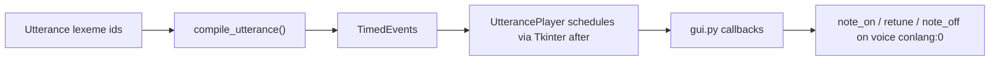

# Python GUI Application for Sonic HRI Project

Python application for corresponding *Teensy Audio Module*. 
Usage is possible either while being connected to the *Teensy Audio Module* or while not being connected to it, playing the sound on the *Local Device* (Details: [Usage](#usage)). 
It is also possible to use a *MIDI Keyboard* as input device. 

## Images:


## Getting Started

### 1. Clone Repo

Clone the repository at your preferred location:

```bash
git clone https://github.tik.uni-stuttgart.de/st200539/audio-module-project.git
```

### 2. Installation/Setup:

Make sure you are located at the project directory:

```bash
cd audio-module-project
```

and run the corresponding commands dependant on your operating system:

#### Windows:

Installation/Setup:

```powershell
python -m venv .venv # Create virtual environment
.\.venv\Scripts\activate # Activate virual environment
pip install -r requirements.txt # Install required python libraries 
```

Start:

```powershell
python Scripts\app.py # Start the application
```

#### Linux (Debian / Ubuntu)

Installation:

> Note: In Linux you may have to take this extra step to install the mentioned underlying system libraries on OS level. On Windows and macOS these system libraries are usually automatically included in the packages.

```bash
sudo apt update 
sudo apt install python3-venv python3-tk libportaudio2 build-essential libasound2-dev 
```

Setup:

```bash
python3 -m venv .venv # Create virtual environment
source .venv/bin/activate # Activate virtual environment
pip install -r requirements.txt # Install required python libraries
```

> Note: If connection to the serial port fails with something like "Permission denied" the current Linux user is probably no member of the group "dialout", which handles serial ports. To fix that run the following command to add the user to the group "dialout". Then close and reopen the terminal or even log out and back in again to apply the changes.

```bash
sudo usermod -aG dialout "$USER"
```

Start:

```bash
python Scripts/app.py # Start the application
```

#### macOS

> Note: Not tested as i got no macOS system.

Installation/Setup: 

```bash
python3 -m venv .venv # Create virtual environment
source .venv/bin/activate # Activate virtual environment
pip install -r requirements.txt # Install required python libraries 
```

Start:

```bash
python Scripts/app.py # Start the application
```

> Note: If you get a Tkinter error, install Python from [python.org](https://www.python.org/downloads/) or via Homebrew (`brew install python-tk`), as the built-in macOS Python may lack Tk support.

## Usage

### Usage Option 1: Connected to the *Teensy Audio Module*:

Steps:

1. Ensure, that the Battery (LiPo) is connected to the amplifier and therefore the speaker. Ensure also that the Battery is loaded (Full: 4.2 V, Half-Full: 3.7 V, Minimum Voltage the Battery should have: 3.2 V).
2. Connect your Local Device to the Teensy Audio Module via USB.
3. Start the Python Application on your Local Device and ensure that the connection to the Teensy is indicated in the field `Serial Connection`.
4. Play sound.

How it works:
The GUI Application sends messages via USB Serial to the Teensy. The messages are in string format (see `Scripts/playback/teensy/protocol.py`). The Teensy receives the messages, handles them and synthesizes sound using the [Teensy Audio Library](https://www.pjrc.com/teensy/td_libs_Audio.html).

### Usage Option 2: Not connected to the *Teensy Audio Module*:

Steps:

1. Start the Python Application on your Local Device
2. Play sound.

How it works: 
While not being connected to the Audio Module, your local device takes care of the sound synthesis utilizing the python libraries `sounddevice` and `numpy`.

### Usage of MIDI Keyboard:

Connect MIDI-Keyboard to your local device , then you will be able to connect it in the GUI indicated in the field `MIDI-Port`.

## Conlang Functionality

A small constructed language (conlang) can be played. Vocabulary lives in `Scripts/conlang/conlang_lexicon.py`. Playback is compiled and scheduled in `Scripts/conlang/conlang_utterance_player.py` and then sent through the same synth voice as keyboard notes.

### Building blocks

Three dataclasses:

- **Phoneme** — one sound. Current helpers: `_beep`, `_glide`, `_warble`.
- **Lexeme** — a word, a sequence of phonemes (e.g. `hello`, `human`, `yes`, `no`).
- **Utterance** — a phrase, a sequence of lexemes (e.g. `greet_human` = "Hallo, Mensch", `acknowledge` = "Verstanden").

Define words in the `LEXEMES` dict:

```python
"hello": Lexeme(
        "hello",
        "Hallo",
        (
            _beep(1650, 55, 30),
            _glide(1500, 2100, 110, 25),
            _beep(1900, 60, 40),
        ),
    ),
```

Define phrases in the `UTTERANCES` dict, e.g. `"greet_human": Utterance("greet_human", "Hallo, Mensch", ("hello", "human"))`.

### Phoneme parameters

- `_beep(hz, duration_ms, gap_after_ms=30)` — steady tone
- `_glide(start_hz, end_hz, duration_ms, gap_after_ms=30)` — frequency ramp
- `_warble(hz, duration_ms, gap_after_ms=30)` — tone that oscillates around `hz`

### Timing

- `gap_after_ms` is silence after each phoneme (default 30 ms).
- `WORD_GAP_MS` (120 ms) is extra silence between lexemes in an utterance, on top of `gap_after_ms`.
- Glide and warble are stepped retunes every `GLIDE_STEP_MS` (16 ms).
- Warble depth is `WARBLES_DEPTH_RATIO` (0.06): the frequency steps through `0`, `+6%`, `0`, `-6%` of the start frequency.

### Playback



- `compile_utterance` turns lexeme ids into timed events (`note_on`, `retune`, `note_off`).
- `UtterancePlayer` schedules those events; the GUI synth callbacks produce the audio.
- Playback goes through the GUI callbacks wired in `Scripts/gui/gui.py`: `on_note_on` → `_note_on`, `on_retune` → `_retune_voice`, `on_note_off` → `_note_off`, all on voice `conlang:0`. `retune` keeps the tone sounding and only changes its frequency (used by glide and warble).

## Project Structure

High level overview of all folders and files. `__init__.py` files (empty package markers) are left out.

The application is split into layers. Data flows from the GUI down to the sound output:

`gui/` (panels + `synth_controller.py`) → `synth/` (state and rules) → `playback/output_router.py` → Teensy (`playback/teensy/`) **or** local sound (`playback/local/`)

### Top level

| Folder or File     | Purpose                                                                                                                                                                                                           |
| :----------------- | :---------------------------------------------------------------------------------------------------------------------------------------------------------------------------------------------------------------- |
| `exports/`         | Contains exported synth setups as .json and .md triggered by "Export" button in the GUI. Basically same functionality as "Save" in the Setup panel but with automatic timestamps and an additional markdown file. |
| `helper_scripts/`  | Helper programs (e.g. for converting a .wav to a .h file), not part of the running application.                                                                                                                   |
| `Scripts/`         | The Python application (GUI, synth logic, sound output, conlang, storage). Start it with `python Scripts/app.py`.                                                                                                 |
| `Scripts-Teensy/`  | Firmware for the Teensy 4.1 (Arduino/Teensyduino sketch). Must be flashed to the Teensy separately, it is not run by the Python app.                                                                              |
| `setups-synth/`    | Saved synth setups as .json (written by the Setup panel in the GUI). `Default.json` and the `Setup-*.json` files are example setups.                                                                              |
| `visuals/`         | Visuals used in this README (GUI screenshot, hardware setup, signal path `Setup-Teensy_Audio_Library.png`).                                                                                                                            |
| `.gitignore`       | Files that stay out of git (virtual environment, `config-gui.json`, wavetable source files, ...).                                                                                                                 |
| `config-gui.json`  | Last used GUI settings (serial port, MIDI port, sliders, ...).                                                                                                                                                    |
| `requirements.txt` | Python packages needed by the application.                                                                                                                                                                        |

### `Scripts/` (Code for Pyhton Application)

| Folder or File                        | Purpose                                                                                                                                                                                                                                                                                                                         |
| :------------------------------------ | :------------------------------------------------------------------------------------------------------------------------------------------------------------------------------------------------------------------------------------------------------------------------------------------------------------------------------ |
| `conlang`                             | Contains functionality regarding constructed language.                                                                                                                                                                                                                                                                          |
| `conlang/conlang_lexicon.py`          | Vocabulary of the constructed language: phonemes, lexemes (words), utterances (phrases). ++Add new conlang elements here.++                                                                                                                                                                                                     |
| `conlang/conlang_utterance_player.py` | Turns utterances into timed events (note on, retune, note off) and schedules them.                                                                                                                                                                                                                                              |
| `gui/`                                | Contains functionality regarding the GUI. |
| `gui/panels/`                         | One module per GUI area: `connection_panel` (serial, MIDI, local audio), `display_panel` (current values, last packet), `keyboard_panel` (on-screen and PC keyboard), `conlang_panel`, `sound_panel` (volume, presets, contains `fm_panel`, `lfo_panel`, `filter_panel`), `setup_panel` (save/load/export setups), `log_panel`. |
| `gui/gui.py`                          | Main window (`SynthApp`). Only builds the panels and wires them to the controller.                                                                                                                                                                                                                                              |
| `gui/midi_input.py`                   | MIDI keyboard input via `mido` (python library). Converts MIDI notes to frequencies.                                                                                                                                                                                                                                            |
| `gui/synth_controller.py`             | Application logic without widget code: note lifecycle, reaction to parameter changes, presets, applying setups, saving the config. Updates the GUI through a `ControllerView` interface.                                                                                                                                        |
| `gui/widgets.py`                      | Shared widget helpers, e.g. slider plus entry field, value blocks.                                                                                                                                                                                                                                                              |
| `playback/`                           | Contains functionality regarding audio playback. |
| `playback/local/engines/base.py`      | Shared constants (sample rate, block size) and DSP helpers (envelope, clipping).                                                                                                                                                                                                                                                |
| `playback/local/engines/fm_engine.py` | FM synthesis on local devices (voices, modulator, envelope) calculated in handled by `sounddevice` and `numpy.`                                                                                                                                                                                                                 |
| `playback/local/audio_engine.py`      | Manages the `sounddevice` (python library) output stream for local playback and hands the audio calculation to the FM engine.                                                                                                                                                                                                   |
| `playback/teensy/protocol.py`         | Builds the text packets sent to the Teensy (note on/off, LFO, filter, LFO table). Format is documented at the top of the file.                                                                                                                                                                                                  |
| `playback/teensy/serial_client.py`    | USB serial connection to the Teensy: connecting, voice slot allocation, sending packets, auto-reconnect watchdog (finds the Teensy again via its USB serial number).                                                                                                                                                            |
| `playback/output_router.py`           | Decides where an event goes: Teensy if connected, otherwise local sound engine, otherwise only the log.                                                                                                                                                                                                                         |
| `storage/`                             | Contains functionality to memorize the last configured gui and synth setup config.                 |
| `storage/config_store.py`             | Loads and saves `config-gui.json` (`AppConfig`).                                                                                                                                                                                                                                                                                |
| `storage/setup_store.py`              | Saves, loads and exports setups (`setups-synth/`, `exports/`).                                                                                                                                                                                                                                                                  |
| `synth/`                              | The synthesizer's state and rules, independent of GUI and sound output.                                                                                                                                                                                                                                                         |
| `synth/fm_utils.py`                   | Helper to compute the modulator frequency ("Fix Hz" or "Ratio" to the carrier).                                                                                                                                                                                                                                                 |
| `synth/lfo_waveform.py`               | LFO waveform presets and the editable waveform. Builds the 256-sample LFO table that is uploaded to the Teensy.                                                                                                                                                                                                                 |
| `synth/safety_limits.py`              | All limits (volume, frequencies, depth, filter, ...) and `clamp_*` functions.                                                                                                                                                                                                                                                   |
| `synth/synth_mode_presets.py`         | FM presets selectable in the GUI.                                                                                                                                                                                                                                                                                               |
| `synth/synth_state.py`                | class`SynthState`: all current parameters (voices, volume, FM, LFO, filter, ...) and PC keyboard mapping.                                                                                                                                                                                                                       |
| `synth/waveforms.py`                  | Carrier waveform names and their IDs. IDs 0-3 match objects of the Teensy Audio Library, 4 is the wavetable on the Teensy.                                                                                                                                                                                                      |
| `app.py`                              | Entry point. Calls `run_app()` from `gui/gui.py`.                                                                                                                                                                                                                                                                               |

### `Scripts-Teensy/` (Firmware Code for Teensy)

| Folder or File | Purpose |
| :--- | :--- |
| `AudioLfo.h` | Own Teensy Audio Library object: LFO that plays the table uploaded from the GUI. |
| `AudioWavetable.h` | Own Teensy Audio Library object: wavetable oscillator with morphing between waveforms. |
| `CustomWavetable.h` | Generated wavetable data (created by `helper_scripts/wav_to_c_header.py`). Do not edit by hand. |
| `teensy_synth.ino` | Main sketch: 8-voice FM/wavetable synthesizer. Reads packets from USB serial, outputs audio over I2S, controls the amplifier shutdown pin (23). The signal path is described at the top of the file and in `visuals/Setup-Teensy_Audio_Library.png`. |

### `helper_scripts/`

| Folder or File       | Purpose                                                              |
| :------------------- | :------------------------------------------------------------------- |
| `wav_to_c_header.py` | Converts a `.wav` wavetable into `Scripts-Teensy/CustomWavetable.h`. |

### Notes for continuing the project

- **Python and firmware share a protocol.** `Scripts/playback/teensy/protocol.py` builds the packets and `Scripts-Teensy/teensy_synth.ino` parses them (note packets, `L` for LFO and filter, `W` for the LFO table). If you change a packet in one place, change it in the other and flash the Teensy again.
- **Where new things belong.** A new GUI area is a new module in `Scripts/gui/panels/`. Logic that reacts to the GUI belongs in `gui/synth_controller.py`, not in the panel. A new parameter needs a limit and a `clamp_`* function in `synth/safety_limits.py`, a field in `synth/synth_state.py`, and (if it should survive a restart) an entry in `storage/config_store.py`.
- **Every sound feature needs two implementations.** Once for the Teensy (firmware) and once for local playback (`playback/local/engines/fm_engine.py`), so the app also works without hardware. Right now the app is in a state where the LFO functionality can only be executed on the Teensy, as this functionality is not implemented in the Python app for local playback yet.

## More Notes

### Teensy Audio Library Setup

Current Setup: 8 Voice polyphonic FM or wavetable synth with LFO oscillator and Filter, see here:


### Description of the Audio Objects

Here i provide a brief description of the TAL objects i used for this setup.

| Audio Object<br>`[Teensy Audio Library Object Name]_([Name of the variable in teensy_synth.ino])` | Purpose                                                                                                                                                                                                                     |
| :--------------------------------------------------------------------------------------------- | :-------------------------------------------------------------------------------------------------------------------------------------------------------------------------------------------------------------------------- |
| `AudioSynthWaveformSine_(modulator)`                                                           | Modulation frequency as sinus waveform with configurable frequency.                                                                                                                                                         |
| `AudioSynthWaveformModulated_(carrier)`                                                        | Carrier frequency. Waveform choosable: 'sine', 'saw', 'square', 'triangle'. Choosing 'wavetable stored on Teensy' switches the synthesis mode from FM to wavetable.                                                         |
| `AudioWavetable_(wavetable)`                                                                   | Audio source that is activated, if 'wavetable stored on Teensy' is chosen as carrier waveform in the GUI. Slider of 'Modulation Depth' switches to 'Morph'. Therefore the morph of the wavetable synthesis can be adjusted. |
| `AudioMixer4_(source_mixer)`                                                                   | Mixer object to enable switching between FM and wavetable synthesis.                                                                                                                                                        |
| `AudioEffectEnvelope_(envelope)`                                                               | Envelope object (Delay, Attack, Hold, Decay, Sustain, Release).                                                                                                                                                             |
| `AudioMixer4_(voice_mixer_[a/b])`                                                              | Mixer object that handles routing of the voices that are played. This object exists only with 4 inputs atm, therefore this setup uses 2 of them to enable 8 voice polyphonic sound synthesis.                               |
| `AudioMixer4_(sum_mixer)`                                                                      | Mixer object to generate a mono signal out of the 2 inputs.                                                                                                                                                                 |
| `AudioLFO_(lfo)`                                                                               | Custom AudioStream object to enable LFO functionality, defined in Scripts-Teensy/AudioLfo.h. It modulates the cutoff frequency of global_filter.                                                                            |
| `AudioFilterStateVariable_(global_filter)`                                                     | Lowpass filter with configurable cutoff frequency and resonance (Q).                                                                                                                                                        |
| `AudioAmplifier_(volume_amp)`                                                                  | Amplifies or attentuates the signal.                                                                                                                                                                                        |
| `AudioOutputI2S2_(i2s2_output)`                                                                | Audio output (I2S on port 2). If you change the wire setup, e.g. you want to use I2S on port 1 of the Teensy, you have to change to AudioOutputI2S.                                                                         |

For more detailed information on the [Teensy Audio Library](https://www.pjrc.com/teensy/td_libs_Audio.html), refer to the documentation.

## Contact

E-Mail: [florianpurschke28@gmail.com](mailto:st200539@stud.uni-stuttgart.de)
