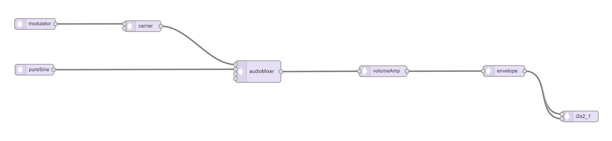

# Python GUI Application for Sonic HRI Project 

Python application for corresponding *Teensy Audio Module*. 
Usage is possible either while being connected to the *Teensy Audio Module* or while not being connected to it, playing the sound on the *Local Device* (Details: [Usage](#usage)). 
It is also possible to use a *MIDI Keyboard* as input device. 

## Images:


## Setup
### 1. Clone Repo
Clone the repository at the preferred location on your *Local Device*:
```bash
git clone https://github.tik.uni-stuttgart.de/st200539/audio-module-project.git
```

### 2. Installation: 
Choose the instructions for your operating system and run the corresponding commands:

#### Windows:

Installation/Setup:

```powershell
cd audio-module-project
python -m venv venv # Create virtual environment
.\venv\Scripts\activate # Activate virual environment
pip install -r requirements.txt # Install required python libraries 
```

Start:

```powershell
python Scripts\app.py # Start the application
```

#### macOS

Installation/Setup: 

```bash
python3 -m venv venv # Create virtual environment
source venv/bin/activate # Activate virtual environment
pip install -r requirements.txt # Install required python libraries 
```

Start:

```bash
python Scripts/app.py # Start the application
```

> Note: If you get a Tkinter error, install Python from [python.org](https://www.python.org/downloads/) or via Homebrew (`brew install python-tk`), as the built-in macOS Python may lack Tk support.


#### Linux (Debian / Ubuntu)

Installation of required system libraries (Tkinter, PortAudio, MIDI build tools):

```bash
sudo apt update 
sudo apt install python3-venv python3-tk libportaudio2 build-essential libasound2-dev 
# Info: In Linux you may have to install underlying system libraries (i.e. 'PortAudio', bc 'sounddevice' in 'requirements.txt' is only a wrapper of 'PortAudio'). On Windows and macOS these system libraries are usually automatically included in the packages.
```

Setup:

```bash
python3 -m venv venv # Create virtual environment
source venv/bin/activate # Activate virtual environment
pip install -r requirements.txt # Install required python libraries
```

Start:

```bash
python Scripts/app.py # Start the application
```


## Usage

### Usage Option 1: Connected to the *Teensy Audio Module*:

Important Info:
Currently the *Teensy Audio Module* is in a prototype state. So please consult Flo, before using it for the first time. ([Contact](#contact))

Besides that, see the Steps for Usage Option 1:
1. Ensure, that the Battery (LiPo) is connected to the amplifier and therefore the speaker. Ensure also that the Battery is loaded (Full: 4.2 V, Half-Full: 3.7 V, Needs to be loaded: 3.2 V).  
2. Connect your Local Device to the Teensy Audio Module via USB. 
3. Start the Python Application on your Local Device  and ensure that the connection to the Teensy is indicated in the field `COM-Port`. 
4. Play sound.

How it works:
The GUI Application sends messages via USB Serial to the Teensy. The messages are in string format (`voiceId,carrierHz,modHz,volumePct,modDepthPct\\n`, see `protocol.py`). The Teensy receives the messages, handles them and synthesizes sound using the [Teensy Audio Library](https://www.pjrc.com/teensy/td_libs_Audio.html).

### Usage Option 2: Not connected to the *Teensy Audio Module*:
Steps:
1. Start the Python Application on your Local Device
2. Play sound.

How it works: 
While not being connected to the Audio Module, the python libraries `sounddevice` and `numpy` are used for Sound Synthesis. I adjusted the configuration options so that every possible configuration in the GUI should also be feasable to implement with the [Teensy Audio Library](https://www.pjrc.com/teensy/td_libs_Audio.html). So you can also play around with sounds when youre not able to connect to the Audio Module (i.e. when you can not come to the Lab).

### Usage of MIDI Keyboard:

Connect MIDI-Keyboard to your local device , then you will be able to connect it in the GUI indicated in the field `MIDI-Port`.


## Project Structure

```
exports/                -   Exported specs for Teensy (JSON + Markdown)
Scripts/
  app.py                -   Application entry point
  gui.py                -   CustomTkinter GUI interface
  engines/              -   Local FM engine and audio router
  audio_engine.py       -   Facade for the LocalSynthRouter
  synth_mode_presets.py -   Presets for FM synthesis
  setup_store.py        -   Save/load/export synth setups
  serial_client.py      -   Serial port communication (Teensy)
  protocol.py           -   Package definition/builder for Teensy communication
  config_store.py       -   Load/save config.json settings
  midi_input.py         -   MIDI keyboard input handling
  synth_state.py        -   Object definition of synth state objects
  fm_utils.py           -   FM utilities (e.g. compute_modulator_hz)
  safety_limits.py      -   Safety limits and value clamping
setups/                 -   Saved setups (JSON)
visuals/                -   Visuals
config.json             -   Config of latest GUI settings (to load last applied settings)
requirements.txt        -   Python modules needed to use this application
```


## More Notes

Here you can see the first setup i tried on the Teensy, which implements monophone FM synthesis: 


And here the second setup, where i added polyphonic functionality (dont get confused by the different visualisation tool i used, it was just more comfortable to use):


## Contact
E-Mail: [st200539@stud.uni-stuttgart.de]((mailto:st200539@stud.uni-stuttgart.de))
Microsoft Teams: [florian.purschke@ms.informatik.uni-stuttgart.de](mailto:florian.purschke@ms.informatik.uni-stuttgart.de)
