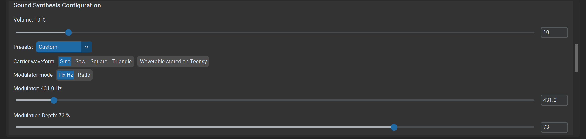
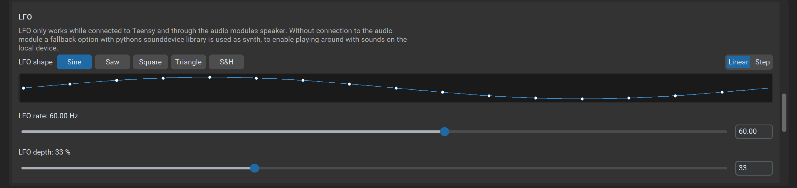
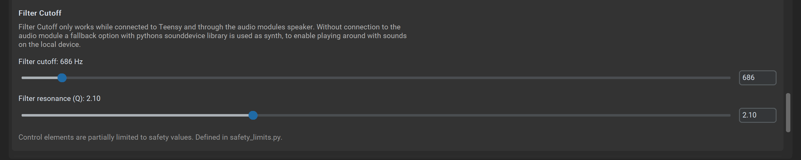
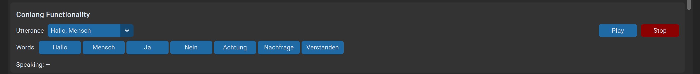
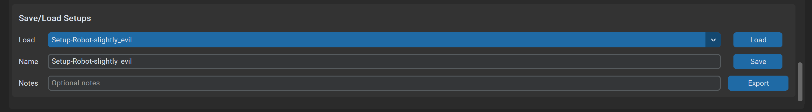
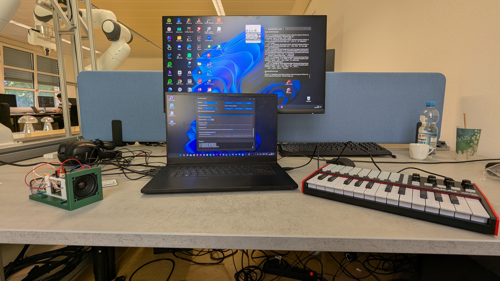
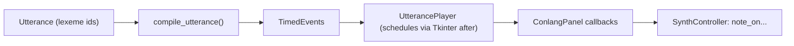
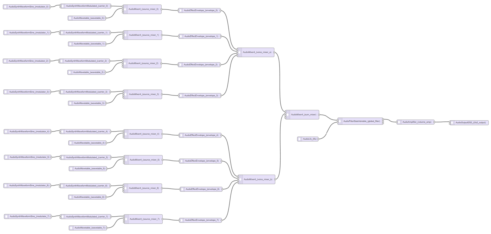

# Audio Module for Sonic HRI Project

This repository contains information and documentation for Teensy Audio Module for the Sonic HRI Project.

Usage is possible either 
- while being connected to the Teensy Audio Module, synthesizing the sound on the Teensy and playing it via the audio module
- or while not being connected to it, synthesizing the sound on your local device and playing it via your loudspeaker (Details: [Usage](#usage)). 
It is also possible to use a MIDI keyboard as input device. 

Outline: 
- [Images](#images)
- [Getting Started](#getting-started)
  - [1. Clone Repo](#1-clone-repo)
  - [2. Installation/Setup](#2-installationsetup)
  - [3. Flashing the Teensy](#3-flashing-the-teensy)
- [Usage](#usage)
  - [Usage Option 1: Connected to the Teensy Audio Module](#usage-option-1-connected-to-the-teensy-audio-module)
  - [Usage Option 2: Not connected to the Teensy Audio Module](#usage-option-2-not-connected-to-the-teensy-audio-module)
  - [Usage of MIDI Keyboard](#usage-of-midi-keyboard)
- [Code](#code)
  - [Project Structure](#project-structure)
  - [Conlang Functionality](#conlang-functionality)
  - [Information about Teensy Audio Library](#information-about-teensy-audio-library)
  - [Notes for continuing the project](#notes-for-continuing-the-project)
- [Hardware Setup](#hardware-setup)
  - [Components](#components)
  - [Pinout](#pinout)
- [Contact](#contact)


## Images:

<table>
  <tr>
    <td colspan="2" valign="top">
      
      <br><sub>Main window: connection, current values and keyboard</sub>
    </td>
  </tr>
  <tr>
    <td width="50%" valign="top">
      
      <br><sub>Sound synthesis configuration</sub>
    </td>
    <td width="50%" valign="top">
      
      <br><sub>LFO</sub>
    </td>
  </tr>
  <tr>
    <td width="50%" valign="top">
      
      <br><sub>Filter cutoff and resonance</sub>
    </td>
    <td width="50%" valign="top">
      
      <br><sub>Conlang functionality</sub>
    </td>
  </tr>
  <tr>
    <td colspan="2" valign="top">
      
      <br><sub>Save/Load setups</sub>
    </td>
  </tr>
</table>



## Getting Started

### 1. Clone Repo

Clone the repository at your preferred location:

```bash
git clone https://github.tik.uni-stuttgart.de/st200539/audio-module-project.git
```

### 2. Installation/Setup:

> Tested with Python 3.12.

Make sure you are located at the project directory:

```bash
cd audio-module-project
```

and run the corresponding commands dependent on your operating system:

#### Windows:

Installation/Setup:

```powershell
python -m venv .venv # Create virtual environment
.\.venv\Scripts\activate # Activate virtual environment
pip install -r requirements.txt # Install required python libraries 
```

Start:

```powershell
python Scripts\app.py # Start the application
```

#### Linux (Debian / Ubuntu)

Installation:

> Note: In Linux you may have to take this extra step to install the mentioned underlying system libraries on OS level. On Windows and macOS these system libraries are usually automatically included in the packages.

```bash
sudo apt update 
sudo apt install python3-venv python3-tk libportaudio2 build-essential libasound2-dev 
```

Setup:

```bash
python3 -m venv .venv # Create virtual environment
source .venv/bin/activate # Activate virtual environment
pip install -r requirements.txt # Install required python libraries
```

> Note: If connection to the serial port fails with the error "Permission denied" or related to that, the current Linux user is probably no member of the group "dialout", which handles serial ports. To fix that run the following command to add the user to the group "dialout". Then close and reopen the terminal or even log out and back in again to apply the changes.

```bash
sudo usermod -aG dialout "$USER"
```

Start:

```bash
python Scripts/app.py # Start the application
```

#### macOS

> Note: Not tested as I got no macOS system.

Installation/Setup: 

```bash
python3 -m venv .venv # Create virtual environment
source .venv/bin/activate # Activate virtual environment
pip install -r requirements.txt # Install required python libraries 
```

Start:

```bash
python Scripts/app.py # Start the application
```


### 3. Flashing the Teensy

Before the Teensy Audio Module can be used (described in [Usage Option 1](#usage-option-1-connected-to-the-teensy-audio-module)), the code in `Scripts-Teensy/` has to be flashed to the Teensy with the [Arduino IDE](https://www.arduino.cc/en/software) (with the [Teensyduino add-on](https://www.pjrc.com/teensy/td_download.html)). This also has to be repeated after every change in `Scripts-Teensy/`.

## Usage

### Usage Option 1: Connected to the Teensy Audio Module:

Steps:

1. IMPORTANT (RISK OF DAMAGING COMPONENTS): Ensure, that the Battery (LiPo) is connected to the amplifier and therefore the speaker. If not connected, parasitic powering effects can occur which can damage the amplifier/speaker. Ensure also that the Battery is loaded (Full: 4.2 V, Half-Full: 3.7 V, Minimum Voltage the Battery should have: 3.2 V). 
2. Connect your Local Device to the Teensy Audio Module via USB.
3. Start the Python Application on your Local Device and ensure that the connection to the Teensy is indicated in the field `Serial Connection`.
4. Play sound.

How it works:
The GUI Application sends messages via USB Serial to the Teensy. The messages are in string format (see `Scripts/playback/teensy/protocol.py`). The Teensy receives the messages, handles them and synthesizes sound using the Teensy Audio Library.

### Usage Option 2: Not connected to the *Teensy Audio Module*:

Steps:

1. Start the Python Application on your Local Device
2. Play sound.

How it works: 
While not being connected to the Audio Module, your local device takes care of the sound synthesis utilizing the python libraries `sounddevice` and `numpy`.

### Usage of MIDI Keyboard:

Connect MIDI-Keyboard to your local device , then you will be able to connect it in the GUI indicated in the field `MIDI-Port`.


## Code

### Project Structure

#### Top level

| Folder or File     | Purpose                                                                                                                                                                                                           |
| :----------------- | :---------------------------------------------------------------------------------------------------------------------------------------------------------------------------------------------------------------- |
| `exports/`         | Contains exported synth setups as .json and .md triggered by "Export" button in the GUI. Basically same functionality as "Save" in the Setup panel but with automatic timestamps and an additional markdown file. |
| `helper_scripts/`  | Helper programs (e.g. for converting a .wav to a .h file), not part of the running application.                                                                                                                   |
| `Scripts/`         | The Python application (GUI, synth logic, sound output, conlang, storage).                                                                                                  |
| `Scripts-Teensy/`  | Firmware for the Teensy 4.1 (Arduino/Teensyduino sketch). Must be flashed to the Teensy separately, it is not run by the Python app.                                                                              |
| `setups-synth/`    | Saved synth setups as .json (written by the Setup panel in the GUI). `Default.json` and the `Setup-*.json` files are example setups.                                                                              |
| `visuals/`         | Visuals used in this README (GUI screenshot, hardware setup, signal path `Setup-Teensy_Audio_Library.png`).                                                                                                                            |
| `wavetables`       | Example wavetables to play around with wavetable synthesis.                                                                                                                                                       |
| `.gitignore`       | Files that stay out of git (virtual environment, `config-gui.json`, wavetable source files, ...).                                                                                                                 |
| `config-gui.json`  | Last used GUI settings (serial port, MIDI port, sliders, ...).                                                                                                                                                    |
| `requirements.txt` | Python packages needed by the application.                                                                                                                                                                        |

#### `Scripts/` (Code for Python Application)

| Folder or File                        | Purpose                                                                                                                                                                                                                                                                                                                         |
| :------------------------------------ | :------------------------------------------------------------------------------------------------------------------------------------------------------------------------------------------------------------------------------------------------------------------------------------------------------------------------------ |
| `conlang`                             | Contains functionality regarding constructed language.                                                                                                                                                                                                                                                                          |
| `conlang/conlang_lexicon.py`          | Vocabulary of the constructed language: phonemes, lexemes (words), utterances (phrases). **Add new conlang elements here.**                                                                                                                                                                                                   |
| `conlang/conlang_utterance_player.py` | Turns utterances into timed events (note on, retune, note off) and schedules them.                                                                                                                                                                                                                                              |
| `gui/`                                | Contains functionality regarding the GUI.                                                                                                                                                                                                                                                                                       |
| `gui/panels/`                         | One module per GUI area: `connection_panel` (serial, MIDI, local audio), `display_panel` (current values, last packet), `keyboard_panel` (on-screen and PC keyboard), `conlang_panel`, `sound_panel` (volume, presets, contains `fm_panel`, `lfo_panel`, `filter_panel`), `setup_panel` (save/load/export setups), `log_panel`. |
| `gui/gui.py`                          | Main window (`SynthApp`). Only builds the panels and wires them to the controller.                                                                                                                                                                                                                                              |
| `gui/midi_input.py`                   | MIDI keyboard input via `mido` (python library). Converts MIDI notes to frequencies.                                                                                                                                                                                                                                            |
| `gui/synth_controller.py`             | Application logic without widget code: note lifecycle, reaction to parameter changes, presets, applying setups, saving the config. Updates the GUI through a `ControllerView` interface.                                                                                                                                        |
| `gui/widgets.py`                      | Shared widget helpers, e.g. slider plus entry field, value blocks.                                                                                                                                                                                                                                                              |
| `playback/`                           | Contains functionality regarding audio playback.                                                                                                                                                                                                                                                                                |
| `playback/local/engines/base.py`      | Shared constants (sample rate, block size) and DSP helpers (envelope, clipping).                                                                                                                                                                                                                                                |
| `playback/local/engines/fm_engine.py` | FM synthesis on local device (voices, modulator, envelope) calculated and handled with `sounddevice` and `numpy`.                                                                                                                                                                                                                 |
| `playback/local/audio_engine.py`      | Manages the `sounddevice` (python library) output stream for local playback and hands the audio calculation to the FM engine.                                                                                                                                                                                                   |
| `playback/teensy/protocol.py`         | Builds the text packets sent to the Teensy (note on/off, LFO, filter, LFO table). Format is documented at the top of the file.                                                                                                                                                                                                  |
| `playback/teensy/serial_client.py`    | USB serial connection to the Teensy: connecting, voice slot allocation, sending packets, auto-reconnect watchdog (finds the Teensy again via its USB serial number).                                                                                                                                                            |
| `playback/output_router.py`           | Decides where an event goes: Teensy if connected, otherwise local sound engine, otherwise only the log.                                                                                                                                                                                                                         |
| `storage/`                            | Contains functionality to memorize the last configured gui and synth setup config.                                                                                                                                                                                                                                              |
| `storage/config_store.py`             | Loads and saves `config-gui.json` (`AppConfig`).                                                                                                                                                                                                                                                                                |
| `storage/setup_store.py`              | Saves, loads and exports setups (`setups-synth/`, `exports/`).                                                                                                                                                                                                                                                                  |
| `synth/`                              | The synthesizer's state and rules, independent of GUI and sound output.                                                                                                                                                                                                                                                         |
| `synth/fm_utils.py`                   | Helper to compute the modulator frequency ("Fix Hz" or "Ratio" to the carrier).                                                                                                                                                                                                                                                 |
| `synth/lfo_waveform.py`               | LFO waveform presets and the editable waveform. Builds the 256-sample LFO table that is uploaded to the Teensy.                                                                                                                                                                                                                 |
| `synth/safety_limits.py`              | All limits (volume, frequencies, depth, filter, ...) and `clamp_*` functions.                                                                                                                                                                                                                                                   |
| `synth/synth_mode_presets.py`         | FM presets selectable in the GUI.                                                                                                                                                                                                                                                                                               |
| `synth/synth_state.py`                | class `SynthState`: all current parameters (voices, volume, FM, LFO, filter, ...) and PC keyboard mapping.                                                                                                                                                                                                                       |
| `synth/waveforms.py`                  | Carrier waveform names and their IDs. IDs 0-3 match objects of the Teensy Audio Library, 4 is the wavetable on the Teensy.                                                                                                                                                                                                      |
| `app.py`                              | Entry point. Calls `run_app()` from `gui/gui.py`.                                                                                                                                                                                                                                                                               |

#### Scripts-Teensy/ (Firmware Code for Teensy)

| Folder or File | Purpose |
| :--- | :--- |
| `AudioLfo.h` | Own Teensy Audio Library object: LFO that plays the table uploaded from the GUI. |
| `AudioWavetable.h` | Own Teensy Audio Library object: wavetable oscillator with morphing between waveforms. |
| `CustomWavetable.h` | Generated wavetable data (created by `helper_scripts/wav_to_c_header.py`). Do not edit by hand. |
| `teensy_synth.ino` | Main sketch: 8-voice FM/wavetable synthesizer. Reads packets from USB serial, outputs audio over I2S, controls the amplifier shutdown pin (23). The signal path is described at the top of the file and in `visuals/Setup-Teensy_Audio_Library.png`. |

#### `helper_scripts/`

| Folder or File       | Purpose                                                              |
| :------------------- | :------------------------------------------------------------------- |
| `wav_to_c_header.py` | Converts a `.wav` wavetable into `Scripts-Teensy/CustomWavetable.h`. |


### Conlang Functionality

A small constructed language (conlang) can be played. Vocabulary lives in `Scripts/conlang/conlang_lexicon.py`. Playback is compiled and scheduled in `Scripts/conlang/conlang_utterance_player.py` and played on its own synth voice (`conlang:0`).

#### Building blocks

- **Phoneme**: one sound (`_beep`, `_glide` or `_warble`).
- **Lexeme**: a word, a sequence of phonemes (e.g. `hello`, `human`, `yes`).
- **Utterance**: a phrase, a sequence of lexemes (e.g. `greet_human` = "Hallo, Mensch").

To add a word, add a `Lexeme` to the `LEXEMES` dict. To add a phrase, add an `Utterance` to `UTTERANCES`. Timing constants (word gap, glide step, warble depth) are at the top of the two conlang files.

#### Playback



## IDE Setup 

### Language Servers
To enable features like code navigation, type tooltips and syntax checking, configure the following language servers in your IDE: 

### Python:
* **Language Server:** *Pylance* (or *Pyright*)

In my case (VSCode) that worked right away. Python language servers were configurable straight forward in the settings.

### C++
* **Language Server:** *clangd*
  
To ensure *clangd* correctly resolves hardware libraries (like `<Arduino.h>`), follow these steps to set up your environment:
1. **Generate the Compilation Database:**
   Run the following command in your project root to generate the `compile_commands.json` file:
   ```bash
   arduino-cli compile --fqbn teensy:avr:teensy41 --only-compilation-database firmware/teensy_synth
2. Configure `clangd`:
   Create a local file named exactly `.clangd` in your project root. You can use the provided `.clangd.example.yaml` as a template and adjust the paths to match your local toolchain installation.


### Information about Teensy Audio Library

#### Teensy Audio Library Setup

Current Setup: 8 Voice polyphonic FM or wavetable synth with LFO oscillator and Filter, see here:



#### Description of the Audio Objects

Brief description of the TAL objects used in this setup.

| Audio Object<br>`[Teensy Audio Library Object Name]_([Name of the variable in teensy_synth.ino])` | Purpose                                                                                                                                                                                                                     |
| :--------------------------------------------------------------------------------------------- | :-------------------------------------------------------------------------------------------------------------------------------------------------------------------------------------------------------------------------- |
| `AudioSynthWaveformSine_(modulator)`                                                           | Modulation frequency as sinus waveform with configurable frequency.                                                                                                                                                         |
| `AudioSynthWaveformModulated_(carrier)`                                                        | Carrier frequency. Waveform choosable: 'sine', 'saw', 'square', 'triangle'. Choosing 'wavetable stored on Teensy' switches the synthesis mode from FM to wavetable.                                                         |
| `AudioWavetable_(wavetable)`                                                                   | Audio source that is activated, if 'wavetable stored on Teensy' is chosen as carrier waveform in the GUI. Slider of 'Modulation Depth' switches to 'Morph'. Therefore the morph of the wavetable synthesis can be adjusted. |
| `AudioMixer4_(source_mixer)`                                                                   | Mixer object to enable switching between FM and wavetable synthesis.                                                                                                                                                        |
| `AudioEffectEnvelope_(envelope)`                                                               | Envelope object (Delay, Attack, Hold, Decay, Sustain, Release).                                                                                                                                                             |
| `AudioMixer4_(voice_mixer_[a/b])`                                                              | Mixer object that handles routing of the voices that are played. This object exists only with 4 inputs atm, therefore this setup uses 2 of them to enable 8 voice polyphonic sound synthesis.                               |
| `AudioMixer4_(sum_mixer)`                                                                      | Mixer object to generate a mono signal out of the 2 inputs.                                                                                                                                                                 |
| `AudioLFO_(lfo)`                                                                               | Custom AudioStream object to enable LFO functionality, defined in Scripts-Teensy/AudioLfo.h. It modulates the cutoff frequency of global_filter.                                                                            |
| `AudioFilterStateVariable_(global_filter)`                                                     | Lowpass filter with configurable cutoff frequency and resonance (Q).                                                                                                                                                        |
| `AudioAmplifier_(volume_amp)`                                                                  | Amplifies or attenuates the signal.                                                                                                                                                                                        |
| `AudioOutputI2S2_(i2s2_output)`                                                                | Audio output (I2S on port 2). If you change the wire setup, e.g. you want to use I2S on port 1 of the Teensy, you have to change to AudioOutputI2S.                                                                         |

For more detailed information on the [Teensy Audio Library](https://www.pjrc.com/teensy/td_libs_Audio.html), refer to the documentation.

### Notes for continuing the project

- **Python and firmware share a protocol.** The packet formats are documented in `Scripts/playback/teensy/protocol.py` and at the top of `Scripts-Teensy/teensy_synth.ino`. If you change one side, change the other and flash the Teensy again.
- **Every sound feature needs two implementations**: one for the Teensy and one for local playback (`playback/local/engines/fm_engine.py`). Currently the LFO, the filter and the wavetable carrier only exist on the Teensy. That's because [Usage Option 1](#usage-option-1-connected-to-the-teensy-audio-module) uses the Teensa Audio Library for sound synthesis while [Usage Option 2](#usage-option-2-not-connected-to-the-teensy-audio-module) uses python libraries.
- **New parameters** are best added by following an existing one, e.g. `filter_cutoff_hz`. Search for it to see every place that has to be touched (limits, state, config, GUI, protocol).


## Hardware Setup

### Components
| Microcontroller | Amplifier | LiPo Charging Module | Battery | Loudspeaker |
|:------------------------:|:-----------------------:|:----------------------------:|:-----------------------------:|:-------------------------:|
| Teensy 4.1      | MAX98357A | Soldered Li-Ion Charger With Protection [Link](https://github.com/SolderedElectronics/Li-ion-charger-with-protection-hardware-design) | Akyga LP753636 3.7V 1000mAh DC2509  | Visaton FRWS 5 4Ohm Impedanz |
=======

### Pinout

|        |        Teensy 4.1        |        Amplifier        |        Li-Ion Charger        |        Lipo 1S Battery        |        Loudspeaker        |
|:------:|:------------------------:|:-----------------------:|:----------------------------:|:-----------------------------:|:-------------------------:|
| USB 5V |        Micro USB Port    |                         |                              |                               |                           | 
|        |        Pin 2 (OUT2)      |         DIN             |                              |                               |                           |
|        |        Pin 3 (LRCLK2)    |         LRC             |                              |                               |                           |
|        |        Pin 4 (BCLK2)     |         BCLK            |                              |                               |                           |
|        |        Pin 23            |         SD              |                              |                               |                           |
|        |        GND               |         GND             |        OUT-                  |                               |                           |
|        |                          |         Vin             |        OUT+                  |                               |                           |
|        |                          |                         |        BAT+                  |        + (Red)                |                           |
|        |                          |                         |        BAT-                  |        - (Black)              |                           |
|        |                          |         +               |                              |                               |         +                 |
|        |                          |         -               |                              |                               |         -                 |
  


## Contact

E-Mail: [florianpurschke28@gmail.com](mailto:florianpurschke28@gmail.com)
