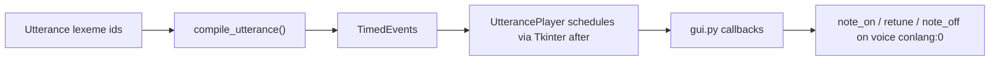
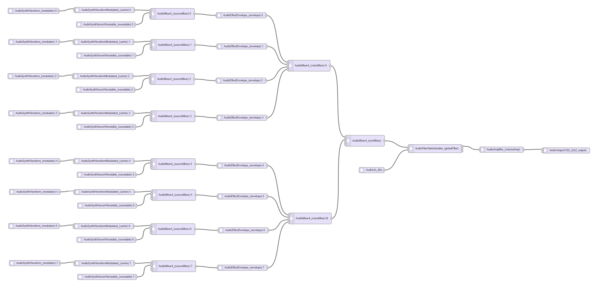

Test []

# Python GUI Application for Sonic HRI Project 

Python application for corresponding *Teensy Audio Module*. 
Usage is possible either while being connected to the *Teensy Audio Module* or while not being connected to it, playing the sound on the *Local Device* (Details: [Usage](#usage)). 
It is also possible to use a *MIDI Keyboard* as input device. 

## Images:


## Setup
### 1. Clone Repo
Clone the repository at the preferred location on your *Local Device*:
```bash
git clone https://github.tik.uni-stuttgart.de/st200539/audio-module-project.git
```

### 2. Installation: 
Choose the instructions for your operating system and run the corresponding commands:

#### Windows:

Installation/Setup:

```powershell
cd audio-module-project
python -m venv venv # Create virtual environment
.\venv\Scripts\activate # Activate virual environment
pip install -r requirements.txt # Install required python libraries 
```

Start:

```powershell
python Scripts\app.py # Start the application
```

#### macOS

Installation/Setup: 

```bash
python3 -m venv venv # Create virtual environment
source venv/bin/activate # Activate virtual environment
pip install -r requirements.txt # Install required python libraries 
```

Start:

```bash
python Scripts/app.py # Start the application
```

> Note: If you get a Tkinter error, install Python from [python.org](https://www.python.org/downloads/) or via Homebrew (`brew install python-tk`), as the built-in macOS Python may lack Tk support.


#### Linux (Debian / Ubuntu)

Installation of required system libraries (Tkinter, PortAudio, MIDI build tools):

```bash
sudo apt update 
sudo apt install python3-venv python3-tk libportaudio2 build-essential libasound2-dev 
# Info: In Linux you may have to install underlying system libraries (i.e. 'PortAudio', bc 'sounddevice' in 'requirements.txt' is only a wrapper of 'PortAudio'). On Windows and macOS these system libraries are usually automatically included in the packages.
```

Setup:

```bash
python3 -m venv venv # Create virtual environment
source venv/bin/activate # Activate virtual environment
pip install -r requirements.txt # Install required python libraries
```

The login user needs access to the serial device (`dialout` on Debian/Ubuntu):

```bash
sudo usermod -aG dialout "$USER"
# Log out and back in so the new group applies.
```

ModemManager or brltty can claim `/dev/ttyACM*` for a short time after the Teensy is plugged in. Auto-reconnect tries again every 2 seconds once the port is free.

Start:

```bash
python Scripts/app.py # Start the application
```


## Usage

### Usage Option 1: Connected to the *Teensy Audio Module*:

Important Info:
Currently the *Teensy Audio Module* is in a prototype state. So please consult Flo, before using it for the first time. ([Contact](#contact))

Besides that, see the Steps for Usage Option 1:
1. Ensure, that the Battery (LiPo) is connected to the amplifier and therefore the speaker. Ensure also that the Battery is loaded (Full: 4.2 V, Half-Full: 3.7 V, Needs to be loaded: 3.2 V).  
2. Connect your Local Device to the Teensy Audio Module via USB. 
3. Start the Python Application on your Local Device  and ensure that the connection to the Teensy is indicated in the field `Serial Connection`. 
4. Play sound.

How it works:
The GUI Application sends messages via USB Serial to the Teensy. The messages are in string format (`voiceId,carrierHz,modHz,volumePct,modDepthPct\\n`, see `Scripts/playback/teensy/protocol.py`). The Teensy receives the messages, handles them and synthesizes sound using the [Teensy Audio Library](https://www.pjrc.com/teensy/td_libs_Audio.html).

### Usage Option 2: Not connected to the *Teensy Audio Module*:
Steps:
1. Start the Python Application on your Local Device
2. Play sound.

How it works: 
While not being connected to the Audio Module, the python libraries `sounddevice` and `numpy` are used for Sound Synthesis. I adjusted the configuration options so that every possible configuration in the GUI should also be feasable to implement with the [Teensy Audio Library](https://www.pjrc.com/teensy/td_libs_Audio.html). So you can also play around with sounds when youre not able to connect to the Audio Module (i.e. when you can not come to the Lab).

### Usage of MIDI Keyboard:

Connect MIDI-Keyboard to your local device , then you will be able to connect it in the GUI indicated in the field `MIDI-Port`.


## Conlang Functionality

A small constructed language (conlang) can be played. Vocabulary lives in `Scripts/conlang/conlang_lexicon.py`. Playback is compiled and scheduled in `Scripts/conlang/conlang_utterance_player.py` and then sent through the same synth voice as keyboard notes.

### Building blocks

Three dataclasses:

- **Phoneme** — one sound. Current helpers: `_beep`, `_glide`, `_warble`.
- **Lexeme** — a word, a sequence of phonemes (e.g. `hello`, `human`, `yes`, `no`).
- **Utterance** — a phrase, a sequence of lexemes (e.g. `greet_human` = "Hallo, Mensch", `acknowledge` = "Verstanden").

Define words in the `LEXEMES` dict:

```python
"hello": Lexeme(
        "hello",
        "Hallo",
        (
            _beep(1650, 55, 30),
            _glide(1500, 2100, 110, 25),
            _beep(1900, 60, 40),
        ),
    ),
```

Define phrases in the `UTTERANCES` dict, e.g. `"greet_human": Utterance("greet_human", "Hallo, Mensch", ("hello", "human"))`.

### Phoneme parameters

- `_beep(hz, duration_ms, gap_after_ms=30)` — steady tone
- `_glide(start_hz, end_hz, duration_ms, gap_after_ms=30)` — frequency ramp
- `_warble(hz, duration_ms, gap_after_ms=30)` — tone that oscillates around `hz`

### Timing

- `gap_after_ms` is silence after each phoneme (default 30 ms).
- `WORD_GAP_MS` (120 ms) is extra silence between lexemes in an utterance, on top of `gap_after_ms`.
- Glide and warble are stepped retunes every `GLIDE_STEP_MS` (16 ms).
- Warble depth is `WARBLES_DEPTH_RATIO` (0.06): the frequency steps through `0`, `+6%`, `0`, `-6%` of the start frequency.

### Playback



- `compile_utterance` turns lexeme ids into timed events (`note_on`, `retune`, `note_off`).
- `UtterancePlayer` schedules those events; the GUI synth callbacks produce the audio.
- Playback goes through the GUI callbacks wired in `Scripts/ui/gui.py`: `on_note_on` → `_note_on`, `on_retune` → `_retune_voice`, `on_note_off` → `_note_off`, all on voice `conlang:0`. `retune` keeps the tone sounding and only changes its frequency (used by glide and warble).


## Project Structure

```
exports/                -   Exported specs for Teensy (JSON + Markdown)
Scripts/
  app.py                -   Application entry point
  ui/                   -   GUI and MIDI input
    gui.py              -   CustomTkinter GUI interface
    midi_input.py       -   MIDI keyboard input handling
  synth/                -   Synth state, waveforms, limits, presets
    synth_state.py      -   Object definition of synth state objects
    synth_mode_presets.py - Presets for FM synthesis
    waveforms.py        -   Carrier waveform names and IDs
    lfo_waveform.py     -   LFO wavetable generation
    fm_utils.py         -   FM utilities (e.g. compute_modulator_hz)
    safety_limits.py    -   Safety limits and value clamping
  playback/
    local/              -   Local sounddevice playback
      audio_engine.py   -   LocalAudioEngine (sounddevice stream + FmEngine)
      engines/          -   FM engine and shared DSP helpers
    teensy/             -   Serial link to the Teensy
      serial_client.py  -   Serial port communication (Teensy)
      protocol.py       -   Package definition/builder for Teensy communication
  conlang/
    conlang_lexicon.py  -   Phonemes, lexemes, utterances
    conlang_utterance_player.py - Compile utterances into timed events and schedule playback
  storage/
    config_store.py     -   Load/save config.json settings
    setup_store.py      -   Save/load/export synth setups
tools/
  wav_to_c_header.py    -   Convert a wavetable WAV into a C header for the firmware
setups/                 -   Saved setups (JSON)
visuals/                -   Visuals
config.json             -   Config of latest GUI settings (to load last applied settings)
requirements.txt        -   Python modules needed to use this application
```

## IDE Setup 

### Language Servers
To enable features like code navigation, type tooltips and syntax checking, configure the following language servers in your IDE: 

### Python:
* **Language Server:** *Pylance* (or *Pyright*)

In my case (VSCode) that worked right away. Python language servers were configurable straight forward in the settings.

### C++
* **Language Server:** *clangd*
  
To ensure *clangd* correctly resolves hardware libraries (like `<Arduino.h>`), follow these steps to set up your environment:
1. **Generate the Compilation Database:**
   Run the following command in your project root to generate the `compile_commands.json` file:
   ```bash
   arduino-cli compile --fqbn teensy:avr:teensy41 --only-compilation-database firmware/teensy_synth
2. Configure `clangd`:
   Create a local file named exactly `.clangd` in your project root. You can use the provided `.clangd.example.yaml` as a template and adjust the paths to match your local toolchain installation.


## More Notes

Current Setup: 8 Voice polyphonic input.



- AudioSynthWaveform (Modulator) => Modulation frequency you can adjust in the GUI via the slider.
- AudioSynthWaveform (Carrier) => Input through Local Device or MIDI-Keyboard. Frequencies are adjustable in the GUI.
- AudioEffectEnvelope => DAHDSR (Delay, Attack, Hold, Decay, Sustain, Release) envelope
- AudioMixer4 => Combining up to 4 signals together
- AudioAmplifier => Amplifies or attentuates a signal 
- AudioOutputI2S2 => Audio output (I2S on Port 2)

For more detailed information, refer to the [Teensy Audio Library](https://www.pjrc.com/teensy/td_libs_Audio.html).


## Contact
E-Mail: [st200539@stud.uni-stuttgart.de](mailto:st200539@stud.uni-stuttgart.de)

Microsoft Teams: [florian.purschke@ms.informatik.uni-stuttgart.de](mailto:florian.purschke@ms.informatik.uni-stuttgart.de)